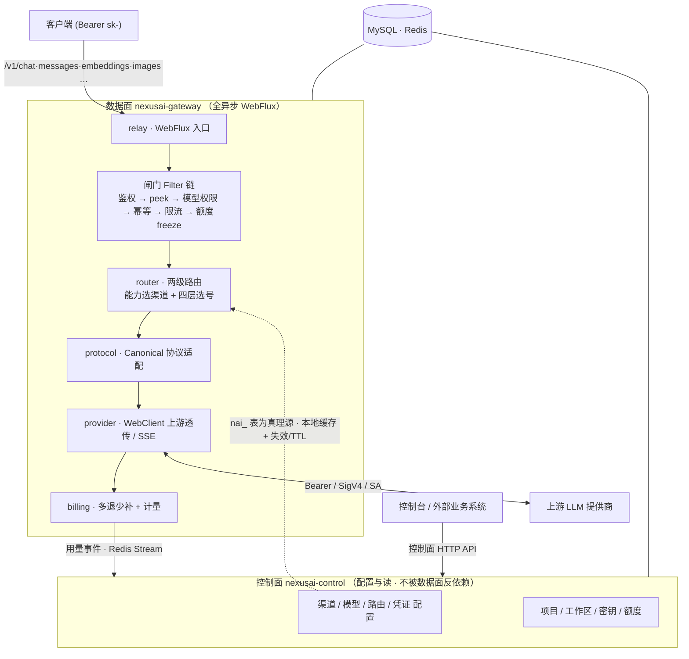

<p align="center">
  
</p>

<h1 align="center">NexusAI Gateway</h1>

<p align="center">
  <b>OpenAI 兼容的独立 AI 中转 / 计费转发网关</b><br/>
  多协议统一转发 · 强闸门计量计费 · Key 池治理 · 全异步反应式数据面
</p>

<p align="center">
  
  
  
  
  
  
</p>

---

## 简介

**NexusAI** 是一个独立部署的 AI 中转网关：客户端用一把 `sk-` 密钥发来任意主流协议（OpenAI / Anthropic / Gemini）的大模型请求，网关完成 **鉴权 → 限流 → 额度强闸门 → 路由选号 → 协议适配 → 上游透传 → 计量计费** 全链路，并把响应（含流式 SSE）原样回送客户端。

数据面全程 **非阻塞反应式**（WebFlux + Reactor Netty + WebClient），瓶颈定位为网络 I/O；金额一律 **整数 micro-USD / BigDecimal**（绝不用浮点），额度走 **Redis 原子预扣强闸门**。网关只做「纯转发面」，钱 / 人 / 账等商业功能可由外部业务系统经控制面 HTTP API 对接，**零运行时耦合、绝不共表**。

- **包根** `com.nexusai`　**库** `nexusai`　**表前缀** `nai_`　**默认端口** `8600`
- 既能**独立运营**（自带 Web 控制台），也能作为**基础设施底座**被业务系统挂接

---

## ✨ 核心特性

| 能力 | 说明 |
|------|------|
| 🔌 **多协议互转** | OpenAI 兼容入口 + Anthropic(`/v1/messages`) / Gemini 原生信封；Canonical 中枢做 OpenAI ↔ Anthropic ↔ Gemini 互转（文本 / 工具调用 / 多模态 / reasoning）；上游 Provider 覆盖 OpenAI / Anthropic / Gemini / Bedrock(SigV4) / Vertex(SA) |
| 💸 **强闸门计费** | 三级额度（项目池 → 工作区钱包 → Key 子限额），请求前 Redis 原子 `freeze` 预扣、流末按真实 usage 多退少补，`freeze ≥ settle` 不变量；结构化 USD 价（input / output / cached / per-image / per-request）|
| 🧭 **两级路由 + Key 池** | 第一级按能力 `priority` 分组 → 加权随机选渠道；第二级**渠道内 Key 池**四层选号（一致性哈希锚定 / 会话粘性 / 多因子打分 TopK / ZSET+Lua 并发槽）|
| 🩺 **健康与熔断** | 渠道级 + Key 级双层熔断状态机（指数退避半开惰性复活）、429 自适应 RPM 学习、跨实例熔断态下沉 Redis + 即时广播 |
| 🔁 **故障转移** | 上游错误分类驱动换 Key / 换渠道重试（小退避）+ 排除集 + 最大重试上限；故障转移链路审计可串查 |
| 🚦 **多维限流** | RPM（令牌桶）+ TPM（分钟窗口 · Lua 原子）+ 并发槽（ZSET+Lua · 服务端时钟防漂移），按 Key / 项目 / 工作区分层 |
| 🌊 **流式 SSE** | 有状态跨协议转码（tool_call 生命周期 / index 映射 / finish_reason）、usage 头尾合并、客户端断连后续 drain 上游保证计费 |
| 🗂 **请求可观测** | 请求日志（MySQL / PostgreSQL / ClickHouse 三选一可替换后端）、P95 / P99 分位、错误分布、每请求可记录请求 / 响应正文 |
| ⏳ **异步任务** | 绘图 / 视频 submit → 预扣 → 进程内轮询 → 完成 / 失败退款 |
| 🔐 **安全** | `sk-` 仅存 SHA-256；上游凭证 AES-256-GCM 版本化轮转；可插拔鉴权 SPI（sk- / JWT）；可信代理 XFF 解析 |
| 🖥 **控制台** | 内置 Web 控制台（渠道 / 模型目录 / 密钥 / 用量 / 健康 / 性能 / 路由 / 代理 / 告警 / 审计 …）|

---

## 🏗 架构



**两条铁律**：① 数据面全程非阻塞；② 数据面不反依赖控制面——路由 / 凭证 / 价格以 `nai_` 表为真理源，热路径走本地缓存 + 显式失效 / TTL 收敛。

---

## 🧱 模块结构

```
nexusai/
├── nexusai-common ............ 基座：R / 分页 / 异常 / 枚举 / 加密原语 / JSON（无业务依赖）
├── nexusai-contract .......... 共享 wire 记录（控制面请求 · 纯记录 · 零依赖）
├── nexusai-persistence ....... 持久化（聚合）：业务库 relational + 日志域（mysql/pg/clickhouse 三选一 + 独立日志库 + 请求体分离库）
├── nexusai-gateway ........... ★数据面（聚合）下挂 10 能力模块：
│     protocol / provider / router / billing / limit / observe / task / relay / auth / runtime
├── nexusai-control ........... ★控制面（单 jar）：admin 会话 + 控制面接口 + 域逻辑（配置与读）
├── nexusai-server-starter .... 可执行入口（main + application.yml + Dockerfile）
├── nexusai-client ............ 外部控制面接入 SDK（client-starter）
├── nexusai-example ........... 最小接入冒烟示例
└── nexusai-admin-ui .......... 独立控制台前端（Vue3 + Naive UI + Vite）
```

依赖单向向下：`server-starter → {gateway, control, client} → {contract, persistence} → common`。

---

## 🛠 技术栈

| 层 | 选型 |
|----|------|
| 框架 | Spring Boot 3.5.13 · WebFlux · Reactor Netty |
| 语言 | Java 21（实测可在 JDK 25 构建运行）|
| 持久化 | MyBatis-Plus · MySQL 8（日志域可选 PostgreSQL / ClickHouse）|
| 缓存 / 并发 | Redis + Redisson（原子 freeze / 并发槽 / 限流 / 熔断态广播）· Caffeine 本地缓存 |
| 上游调用 | WebClient（连接池 + 超时 + 背压）|
| 加密 | AES-256-GCM（凭证）· SHA-256（密钥）|
| 前端 | Vue 3 · Naive UI · Vite · UnoCSS · Pinia |

---

## 🚀 快速开始

**环境**：JDK 21+　·　Maven 3.9+　·　MySQL 8　·　Redis

```bash
# 1. 建库
mysql -h127.0.0.1 -uroot -p -e "CREATE DATABASE IF NOT EXISTS nexusai DEFAULT CHARSET utf8mb4;"

# 2. 表结构
mysql -h127.0.0.1 -uroot -p nexusai < script/sql/nexusai.sql

# 3. 演示数据（可选 · 一站式灌入渠道/模型/项目/请求日志/运维数据 · 便于体验控制台）
mysql -h127.0.0.1 -uroot -p nexusai < script/sql/nexusai-demo.sql

# 4. 构建 & 运行
mvn clean package
java -jar nexusai-server-starter/target/nexusai-server-starter.jar

# 5. 验证（演示 Key 仅供本地联调，勿入生产）
curl --noproxy '*' http://127.0.0.1:8600/actuator/health        # {"status":"UP"}
curl --noproxy '*' -X POST http://127.0.0.1:8600/v1/chat/completions \
  -H 'Authorization: Bearer sk-demo-biz-001' -H 'Content-Type: application/json' \
  -d '{"model":"gpt-4o","messages":[{"role":"user","content":"hi"}]}'
```

控制台默认账号 `admin / admin123`（前端 `nexusai-admin-ui` 单独 `pnpm install && pnpm dev`）。

---

## ⚙️ 关键配置

| 配置 / 环境变量 | 默认 | 说明 |
|------|------|------|
| `SERVER_PORT` | `8600` | 服务端口 |
| `DB_HOST` / `DB_PORT` / `DB_NAME` | `127.0.0.1` / `3306` / `nexusai` | 业务库 |
| `REDIS_HOST` / `REDIS_PORT` | `127.0.0.1` / `6379` | Redis |
| `NEXUSAI_CRYPTO_KEY` | — | 凭证加密密钥（32B Base64 · 生产强制）|
| `NEXUSAI_LOG_STORE` | `mysql` | 请求日志后端：`mysql` / `pg` / `clickhouse`（三选一）|
| `LOG_BODY_STORE` | `rdb` | 请求体记录：`rdb`（独立库存正文）/ `hash`（只存 sha256）|

---

## 🔌 作为基础设施接入

NexusAI 是独立服务，外部业务系统作为**控制面客户端**接入（两种方式择一或并用）：

- **控制面 HTTP API**：调 `POST /admin/keys`（密钥同步）、`/admin/quota/op`（额度充退）、`/admin/channels`、`/admin/models` … 头部 `NexusAI-Admin-Token`
- **SDK**：依赖 `nexusai-client-starter`，注入 `NexusAiAdminClient` 调用

用量由网关经 **Redis Stream** 主动回传业务侧入账。身份真理源在业务侧、网关只持投影；独立运营时网关自管。

---

## 📁 数据库脚本

| 文件 | 用途 |
|------|------|
| `script/sql/nexusai.sql` | MySQL 表结构（24 张 `nai_` 表 · 可重入 `CREATE IF NOT EXISTS`）|
| `script/sql/nexusai-demo.sql` | 演示数据（渠道 / 模型目录 / 项目 / 500+ 请求日志 + 正文 / 运维数据 · 幂等可重复灌）|
| `script/sql/postgres/nexusai_pg.sql` | PostgreSQL 表结构 |

---

## 📄 License

本项目基于 **[GNU AGPLv3](LICENSE)** 授权，并附加 AGPLv3 §7 条款：再分发 / 修改 / 以网络服务形态提供时，须**保留版权与「NexusAI」来源标识**、依 §13 向用户提供源码获取途径、并自行履行所在司法辖区的合规义务。若贵组织无法接受 AGPLv3 的开源义务（商用授权），请联系维护者获取替代授权。
